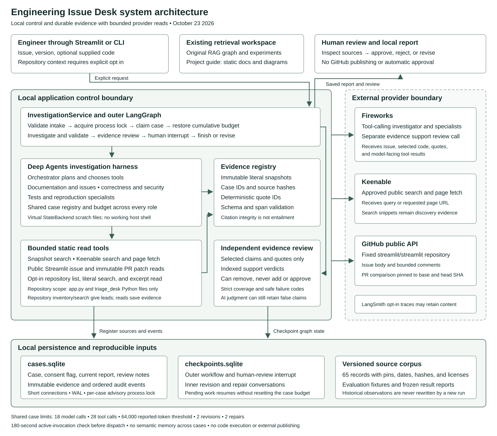
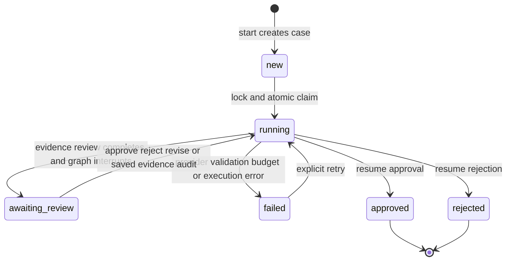

# Engineering Issue Desk architecture

Version date: October 23, 2026.

Engineering Issue Desk turns a Streamlit issue report into a saved, cited investigation that an engineer can review. The agent chooses research tools and specialist delegation; application code controls source identities, execution limits, durable state, and the final review decision. A report can have exact citations and still contain an incorrect conclusion.

This document describes the implemented Week 3 system, including opt-in repository context reads. The [design decisions](DESIGN.md) explain the tradeoffs, the [operations guide](OPERATIONS.md) covers running and recovering the workspace, and the [validation record](VALIDATION.md) separates measured behavior from remaining limits.

## System view



Open the [standalone component diagram](week3-system-architecture.svg) or [investigation sequence](week3-investigation-sequence.svg) for a larger view. The older [five-stage overview](week3-architecture.svg) remains a compact submission illustration.

## Components and ownership

| Component | Responsibility | Main implementation |
| --- | --- | --- |
| Streamlit application | Existing retrieval views plus Deep Investigation intake, saved-case selector, source inspection, review, and downloads | [app.py](../app.py), [agent_ui.py](../triage_desk/agent_ui.py) |
| Project guide | Eighth application tab: fixed authored architecture, diagrams, design, operations, validation, and submission files, with downloads; opening it makes no provider call | [project_guide.py](../triage_desk/project_guide.py) |
| Command line client | Explicit start, probe, show, list, retry, audit, and review operations using the same service | [investigate_deep.py](../scripts/investigate_deep.py) |
| Investigation service | Input/configuration checks, execution claim, shared budget, outer graph, and recovery | [deep_investigation.py](../triage_desk/deep_investigation.py) |
| Deep Agents harness | Planning, tool selection, specialist delegation, virtual files, and structured report generation | `build_deep_investigator` |
| Specialist roles | Documentation/issues, correctness/security, and tests/reproduction; all share case evidence and limits | `general-purpose`, `correctness_security`, `test_reproduction` |
| Domain read tools | Bounded snapshot, Keenable, and public Streamlit GitHub reads | [agent_tools.py](../triage_desk/agent_tools.py) |
| Repository context tools | Explicitly enabled inventory, literal search, and evidence excerpt reads within the application Python allowlist | [repository_context.py](../triage_desk/repository_context.py) |
| Case evidence registry | Immutable snapshots, deterministic quote IDs, citation checks, and escaped report rendering | [agent_evidence.py](../triage_desk/agent_evidence.py) |
| Independent evidence reviewer | One separate tool-constrained model call that can remove findings or next steps; cannot author replacements or approve | [agent_review.py](../triage_desk/agent_review.py) |
| Shared accounting | Reserve calls before dispatch, collect reported usage and safe metadata, enforce limits | [agent_budget.py](../triage_desk/agent_budget.py) |
| Local durable store | Cases, evidence records, audit events, process locks, and abandoned-run recovery | [cases.py](../triage_desk/cases.py) |
| LangGraph checkpoints | Outer workflow state and inner agent conversations, including incomplete steps and review interrupts | `checkpoint_saver` and `SqliteSaver` |
| Existing RAG engine | Versioned corpus, keyword/local or hosted embedding retrieval, and the separate Week 2 workflow | [core.py](../triage_desk/core.py), [workflow.py](../triage_desk/workflow.py) |

The original investigation path and the new agent path coexist. Deep Investigation uses bounded keyword search of the bundled corpus; it does not silently enable hosted embeddings or reuse the original Nebius claim verifier. The independent Fireworks reviewer is specific to the new path.

## Request and evidence flow

1. An engineer supplies an issue, optional reported version, and optional code. Start validates limits before creating a UUID case.
2. The service acquires a nonblocking process lock and atomically changes the eligible case to `running`. It reconstructs cumulative usage from durable events.
3. The outer graph enters `investigate`. Explicitly supplied code becomes case evidence. The inner Deep Agents loop plans, calls tools, and delegates when useful.
4. Each successful source read registers literal text and provenance. Models receive deterministic `quote_spans`; model-facing results avoid duplicating the raw source text. Specialists can list/read the same registry.
5. The model returns JSON findings, proposed next steps, and missing information. Supports contain `evidence_id` and `quote_id`; Python validates the schema, source ownership, and literal span before saving a draft.
6. `evidence_review` sends selected claims, proposed steps, and their selected quotes to a separate model call. It validates complete indexed verdict coverage, removes rejected items, rechecks citations, and records the review result.
7. `human_review` interrupts the graph. The service records `awaiting_review`; the UI shows retained findings, exact passages, provenance, review notes, and the timeline.
8. Approval or rejection resumes the saved interrupt without a model call and saves a local final decision. A revision starts another investigation with the original request, prior report, and reviewer notes.

Citation validation is a deterministic operation within the `investigate` node, rather than a separately compiled graph node. `evidence_review` and `human_review` are separate graph nodes.

## Workflow and state transitions



While `running`, the graph follows:

```text
investigate
  └─ schema and literal citation validation
       └─ evidence_review
            └─ human_review interrupt
                 ├─ approve or reject → finish
                 └─ revise → increment revision → investigate
```

The store also recognizes `needs_revision`, but the current service uses `running` plus a graph revision counter for revisions. Do not interpret every enumerated store status as an active service transition.

An older saved draft can be `awaiting_review` without a completed evidence audit. Approval is blocked until its audit is completed or has no reviewable content. The explicit saved-evidence audit runs the review stage without repeating research. Rejection can still record that the old draft is unacceptable.

## Persistence and data model

All private operational state lives under ignored `.cache/agent/`:

| Artifact | Stored content | Recovery role |
| --- | --- | --- |
| `cases.sqlite` / `cases` | UUID, issue, reported version, code context, immutable repository opt-in, status, timestamps, current report, Markdown, review notes, safe error | Workspace case list and current artifact |
| `cases.sqlite` / `evidence` | Case ID, source key, SHA-256, immutable source JSON | Revalidate and reopen the exact evidence used |
| `cases.sqlite` / `events` | Ordered event IDs, UTC timestamps, safe event JSON | Reconstruct usage, stages, repairs, and observed errors |
| `checkpoints.sqlite` | LangGraph checkpoints and pending writes | Resume the outer graph and inner agent steps |
| `locks/<case UUID>.lock` | Retained advisory-lock file | Prevent concurrent execution of one case |

Evidence identity derives from case ID, source key, and text hash. Re-registering identical text under the same key returns its original snapshot; changed text creates a different evidence record. Provenance includes source URL/type, origin, retrieval/snapshot/publication dates when available, version scope, immutable commit references, filename, and truncation indicators.

Quote IDs such as `ev_…:q1` are derived from bounded overlapping character spans of saved text. They are a projection of the source, not trusted caller input. New structured-response checkpoints contain JSON dictionaries. A restricted serializer allowlist supports older application report objects; it does not permit arbitrary module imports.

Thread identity is stable and explicit:

- Outer graph: the case UUID.
- Research iteration: `<case>:agent:<revision>`.
- Invalid-report repair: `<case>:agent:<revision>:repair:<global repair number>`.

Repair events determine the active thread for each revision. A pending repair resumes its saved work. A completed invalid report can start a fresh conversation with the original request and saved evidence; failed conversation history is excluded, but usage limits remain cumulative. Legacy repair events without revision/number fields map to revision zero and their chronological global number.

## Tools and boundaries

| Read capability | Scope and limit | Evidence meaning |
| --- | --- | --- |
| `search_knowledge_base` | Keyword retrieval; at most five passages from the 65-source corpus | Snapshot text with its original date/version |
| `search_web` | Keenable query restricted to approved documentation and Streamlit repository pages; at most five accepted snippets | Discovery evidence, not a full-page conclusion |
| `fetch_web_page` | Approved HTTPS hosts only; requested and returned URLs checked; 6,000-character content bound | Fetched excerpt, possibly truncated |
| `read_github_issue` | `streamlit/streamlit`; issue body and up to five comments | Attributed public reports and observed state |
| `read_github_pr` | Fixed repository; observed base/head SHAs and up to five patches | Partial static code evidence pinned to commits |
| Registry list/read | Sources already registered in this case | Exact evidence shared across specialists |

Allowed page hosts are `docs.streamlit.io`, `docs.python.org`, `docs.langchain.com`, and `github.com`; GitHub page paths must stay under `streamlit/streamlit`. Provider API origins are fixed. Redirects are not followed. Tool requests have bounded timeouts and response sizes. Credentials are server-side configuration, never tool arguments.

Deep Agents uses a virtual `StateBackend`. Its scratch files are agent state; they are not access to the repository or host filesystem. No working host shell, reproduction runner, GitHub write tool, automatic issue posting, or automatic approval is implemented.

### Opt-in repository context

The three tools `list_repository_files`, `search_repository`, and `read_repository_file` exist only when `start(..., repository_context=True)` is explicitly selected. CLI `--repository-context` and the UI's default-off **Include related application code** option persist an immutable choice in the case. Retry and revision inherit it. The allowlist is `app.py` and Python files below `triage_desk/`; consent covers bounded static context sent to Fireworks, without execution or modification.

| Operation | Implemented bounds and result |
| --- | --- |
| Inventory | At most 80 files, 400 directory entries, 20 directories, depth 5; filenames and sizes only |
| Search | Case-insensitive literal query, at most 160 characters; at most 512,000 bytes and 100,000 characters across bounded file prefixes, with character allowance shared across indexed files; at most 12 matches, each at most 400 characters |
| Explicit read | UTF-8 file at most 256,000 bytes; default 120 inclusive lines, maximum 160 lines and 8,000 literal code characters, preserving whole lines; line indices at most 100,000 |
| Evidence registration | Explicit reads save a case-scoped `repository_excerpt`, relative path, line range, full-file/excerpt hashes, timestamp, and static-inspection provenance; inventory/search leads are not citation sources |

Every path component is opened with file-descriptor-based no-follow checks. Symlinks, hardlinks, nonregular files, hidden/excluded paths, and concurrent file changes during a read are rejected. Whole-file credential guards run before any content is returned, using configured forbidden values and common credential patterns. This is a heuristic guard, not general secret classification.

The working tree is read when a tool runs; it is not frozen at case creation. Each registered excerpt is immutable, and a later changed file creates a different hash/evidence ID. Bounded prefix search can miss later lines. A tool must explicitly read the located helper before citing it, and no bounded excerpt establishes that omitted behavior is absent.

## Trust and deployment boundaries

User reports, source pages, issue comments, code, and model outputs are data. They do not grant permissions or change tool scope. A model can request a tool call, but Python validates its arguments and the configured read boundary. Saved source IDs establish provenance; the AI reviewer and human assess relevance and causal support separately.

Fireworks receives issue/code context, model-facing tool results, and selected quotes. Keenable receives search queries and page URLs. GitHub receives public read requests and an optional token. Optional LangSmith tracing may retain model/tool content. The local database can contain user input and literal source text; it is not an encrypted or tenant-isolated secret store.

The supported operating model is one personal local workspace on macOS or Linux, using `fcntl` locks and local SQLite storage. Hosted multi-user authorization, per-tenant isolation, remote durable execution, secret classification for arbitrary code, and Mem0 recall across cases are not implemented.

## Evidence of behavior

The [validation matrix](OPERATIONS.md#validation-matrix) links executable checks to each boundary. The frozen [three-sample evaluation](../evaluation/week3-results/report.json) predates repository-context reads: two cases reached saved human review and one failed reviewer-response validation. All three drafts passed literal citation checks, including the failed case. The run used saved evidence reads, not delegation or Keenable; the separate provider probe tested connectivity. The [engineering review](../evaluation/week3-results/engineering-review.md) records retained false positives. These observations establish neither human accuracy nor a production success rate.

The separate [repository-context run](../evaluation/week3-context-results/report.json) reached human review for all three scheduled cases, with 12 model calls, six tools, and 70,046 reported tokens across the three cases. Its observed tools were two saved-evidence reads, one repository inventory, and three repository reads. One read hit the line-range bound; subsequent bounded reads succeeded. It did not use repository search, Keenable, delegation, or read `_configuration`. Avoiding an earlier missing-helper claim does not establish that the agent inspected that helper. The current suite passed 473 tests; the [validation record](VALIDATION.md) records the complete observed scope.
